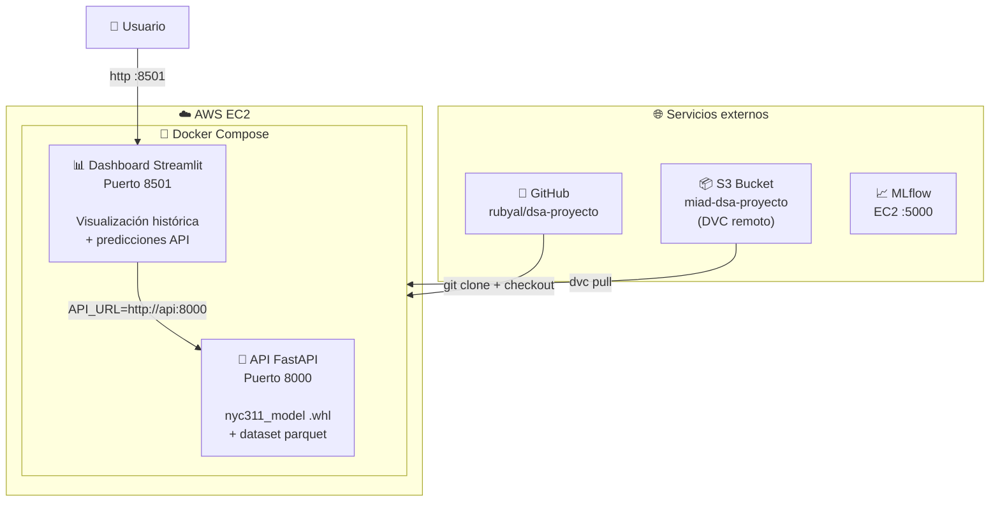
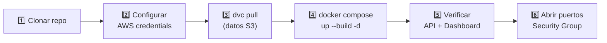
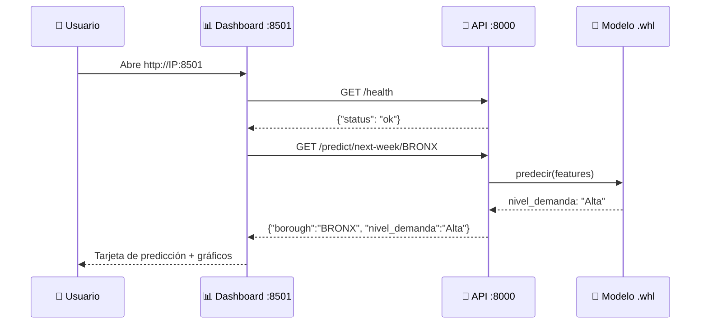

# Manual de instalación — NYC 311 Predicción de Demanda

**Proyecto:** Despliegue de Soluciones Analíticas (MIAD) · Entrega 3
**Equipo:** Laura Vásquez, Ruby Alvarez, Jorge Lopera
**Versión:** 1.0 · Noviembre 2026

---

## 1. Prerrequisitos

Antes de iniciar, asegúrese de tener instalado:

| Herramienta | Versión mínima | Verificar con |
|-------------|---------------|---------------|
| Git | 2.30+ | `git --version` |
| Docker | 24.0+ | `docker --version` |
| Docker Compose | 2.20+ (incluido en Docker Desktop) | `docker compose version` |
| DVC | 3.0+ | `dvc --version` |
| Python | 3.10+ (solo si ejecuta sin Docker) | `python3 --version` |
| AWS CLI | 2.0+ (para DVC con S3) | `aws --version` |

**Credenciales AWS:** se requieren credenciales válidas de AWS Academy para descargar los datos versionados en S3. Consulte la sección 3.

---

## 2. Clonar el repositorio

```bash
git clone https://github.com/rubyal/dsa-proyecto.git
cd dsa-proyecto
git checkout dev
```

---

## 3. Configurar credenciales AWS

Los datasets están versionados con DVC en un bucket S3 (`miad-dsa-proyecto-8fe988a7`). Para descargarlos:

1. Ingrese a **AWS Academy → Learner Lab → Start Lab**.
2. Haga clic en **AWS Details → Show** (sección AWS CLI).
3. Configure las credenciales en su terminal:

```bash
export AWS_ACCESS_KEY_ID=<su_access_key>
export AWS_SECRET_ACCESS_KEY=<su_secret_key>
export AWS_SESSION_TOKEN=<su_session_token>
export AWS_DEFAULT_REGION=us-east-1
```

4. Verifique la conexión:

```bash
aws sts get-caller-identity
```

> **Nota:** las credenciales de AWS Academy expiran cada ~4 horas. Si `dvc pull` falla con error de autenticación, renuévelas repitiendo estos pasos.

---

## 4. Descargar datos con DVC

```bash
dvc pull
```

Verifique que los archivos existan:

```bash
ls -lh data/raw/nyc311_diario_borough_tipo.parquet
ls -lh data/processed/dataset_modelado_semanal.parquet
```

Debe ver dos archivos `.parquet` con tamaño mayor a 0 bytes.

---

## 5. Despliegue con Docker Compose

### 5.1 Construir y levantar los servicios

```bash
docker compose up --build -d
```

Esto levanta dos servicios:
- **api** (puerto 8000): API REST con FastAPI que sirve las predicciones del modelo RidgeClassifier.
- **dashboard** (puerto 8501): tablero Streamlit que consume la API y muestra visualizaciones históricas.

### 5.2 Verificar que los servicios estén corriendo

```bash
docker compose ps
```

Ambos servicios deben aparecer con estado `Up` o `running (healthy)`.

### 5.3 Probar la API

```bash
# Health check
curl http://localhost:8000/health

# Respuesta esperada:
# {"status":"ok","servicio":"NYC311 API"}

# Predicción para un borough
curl http://localhost:8000/predict/next-week/BRONX

# Respuesta esperada (ejemplo):
# {"borough":"BRONX","semana":"2026-01-05","nivel_demanda":"Alta"}
```

### 5.4 Acceder al tablero

Abra en su navegador: **http://localhost:8501**

Verifique:
- Las 5 tarjetas de predicción por borough se muestran.
- El sidebar indica "API de predicción conectada".
- Las secciones Inicio y Análisis cargan sin errores.

---

## 6. Despliegue en AWS EC2

### 6.1 Conectarse a la instancia

```bash
ssh -i <su_llave.pem> ubuntu@<IP_PUBLICA_EC2>
```

### 6.2 Instalar Docker en EC2 (si no está instalado)

```bash
sudo apt-get update
sudo apt-get install -y docker.io docker-compose-plugin git
sudo usermod -aG docker $USER
newgrp docker
```

### 6.3 Clonar, configurar y desplegar

```bash
git clone https://github.com/rubyal/dsa-proyecto.git
cd dsa-proyecto
git checkout dev

# Instalar DVC
pip install dvc[s3]

# Configurar credenciales AWS y descargar datos
export AWS_ACCESS_KEY_ID=<...>
export AWS_SECRET_ACCESS_KEY=<...>
export AWS_SESSION_TOKEN=<...>
export AWS_DEFAULT_REGION=us-east-1
dvc pull

# Construir y levantar
docker compose up --build -d
```

### 6.4 Abrir puertos en Security Group

En la consola de AWS EC2, agregue reglas de entrada (Inbound Rules) al Security Group de la instancia:

| Tipo | Puerto | Origen |
|------|--------|--------|
| Custom TCP | 8000 | 0.0.0.0/0 |
| Custom TCP | 8501 | 0.0.0.0/0 |

### 6.5 Verificar acceso remoto

Desde su navegador:
- API: `http://<IP_PUBLICA_EC2>:8000/health`
- Tablero: `http://<IP_PUBLICA_EC2>:8501`

---

## 7. Detener y reiniciar servicios

```bash
# Detener
docker compose down

# Reiniciar
docker compose up -d

# Ver logs
docker compose logs api --tail 20
docker compose logs dashboard --tail 20
```

> **Importante:** al finalizar la entrega, detenga la instancia EC2 desde la consola de AWS (Stop Instance). **NO la termine (Terminate)**, ya que se perderían los datos y la configuración.

---

## 8. Troubleshooting

| Problema | Solución |
|----------|----------|
| `dvc pull` falla con error de autenticación | Renueve credenciales AWS Academy (sección 3) |
| `dvc pull` falla con `resolve_auth_scheme_preference` | Ejecute `pip install --upgrade dvc[s3] botocore boto3 s3fs aiobotocore` |
| API responde 500 Internal Server Error | Revise logs: `docker compose logs api --tail 30`. Si dice `No module named 'pyarrow'`, agregue `pyarrow` al Dockerfile.api |
| Dashboard muestra "No fue posible cargar predicciones" | Verifique que la API esté corriendo: `curl http://localhost:8000/health` |
| Dashboard no encuentra los parquets | Verifique que ejecutó `dvc pull` antes de `docker compose up --build` |
| Puertos no accesibles en EC2 | Revise Inbound Rules del Security Group (sección 6.4) |
| Contenedores se reinician en loop | Revise logs de ambos: `docker compose logs --tail 50` |

---

## 9. Arquitectura de despliegue



### Flujo de despliegue



### Comunicación entre servicios



**Comunicación interna:** el dashboard consulta la API vía `http://api:8000` (variable `API_URL` en docker-compose.yml). Docker Compose crea una red interna donde los servicios se resuelven por nombre. Los usuarios acceden al tablero por el puerto 8501.
